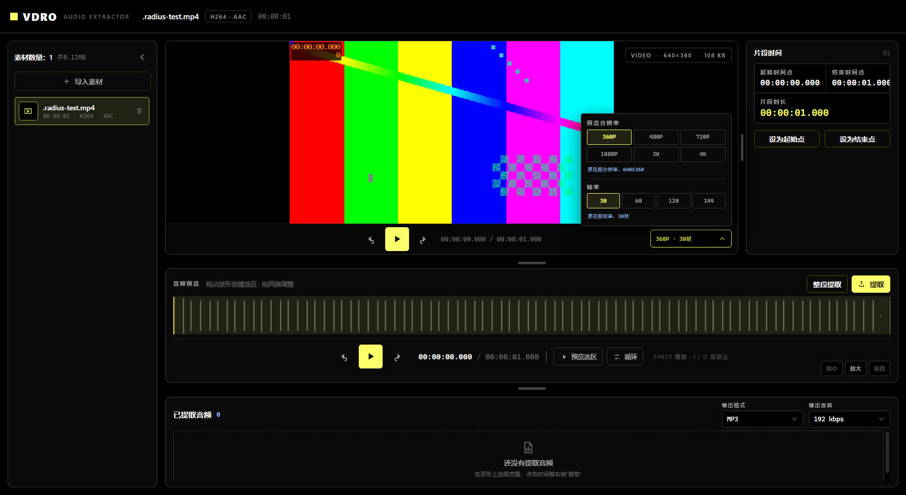

# VDRO

> 本地音视频片段截取工具 —— 在波形上选一段，一键导出，数据不出本机。  
> A local-first Windows desktop tool to cut and export segments from your own audio & video files.

VDRO imports local audio or video files, keeps a material library, lets you select a
region on the waveform with picture/audio-synced preview, extracts the selected range
via FFmpeg, and lets you play, save, or delete every extracted clip.

- **Waveform cutting**: wavesurfer.js waveform with drag selection, in/out points, skip, loop
- **Picture & audio sync**: video preview linked to the waveform, adjustable resolution / frame rate
- **Accurate export**: FFmpeg-based extraction with format, quality, sample-rate and channel options, templated filenames
- **Privacy first**: no uploads, no network service. Settings and records stay on your machine
  (portable builds: `.userdata` inside the app directory; installed builds: `%APPDATA%\VDRO`)



## Quick start (development)

Requires Node.js 18+ and npm.

```bash
git clone <your-repo-url>
cd vdro
npm install
npm run dev        # launch the dev app with hot reload
```

Build and package:

```bash
npm run typecheck  # tsc --noEmit for node & web configs
npm run build      # electron-vite build -> out/
npm run dist       # electron-builder -> release/
```

## Settings

Click the gear icon at the top-right. The settings cover:

- output defaults: format, quality, sample rate, channels, saving mode, filename template
- preview defaults: resolution, frame rate, skip duration, loop, extracted-video sync
- interface: dark/OLED/light/acrylic themes, six material tint colors, optional translucent window, accent color, UI scale, layout/sidebar restore
- data: delete confirmations, temporary-file cleanup, waveform-cache limit/cleanup, material-library/extracted-audio persistence
- shortcuts: play, set-in, set-out, seek back/forward
- reset layout, clear temporary files/waveform cache, and reset all settings

## Portable build

Everything needed to run lives in one self-contained folder:

```text
VDRO\
  VDRO.exe              launcher (built from launcher/VDROLauncher.cs)
  runtime\electron.exe  local Electron runtime
  .userdata\            Electron user data/cache
  out\                  built app
```

The launcher builds once via a C# compiler and starts the runtime with
`--no-sandbox --disable-gpu` as compatibility workarounds for non-system
workspace drives. `start-vdro.cmd` is a fallback that builds (if needed) and
launches the same `VDRO.exe`. For users on this drive, install once with
`npm install`; the portable runtime is already in `runtime\`.

## Installed build

Standard per-user NSIS installer (assisted mode, no administrator rights):

- default install directory `%LOCALAPPDATA%\Programs\VDRO`; data under `%APPDATA%\VDRO`
- Chinese/English UI, themes and accent color, interface scale, independent font size
- remembered window state, always-on-top, start maximized
- temporary-file retention policy, waveform cache management
- creates desktop and Start Menu shortcuts; uninstall keeps user data
- unsigned; SmartScreen may warn; x64 only; no auto-update

## Docs

- UI 截图：`docs/screenshots/`
- ClickHouse-inspired dark UI reference: `reference/clickhouse-DESIGN.md`

## License

Released under the [MIT License](LICENSE).

Note: this prototype bundles FFmpeg from `ffmpeg-static`, which is a GPL build.
FFmpeg runs as an external binary invoked by the app, but if you redistribute a
build you should review GPL/LGPL and H.264 obligations — for a closed-source
commercial release, swap in an LGPL FFmpeg build and review licensing again.

## Roadmap

The current UI supports one clip region at a time; multiple regions and batch
export are future work.
