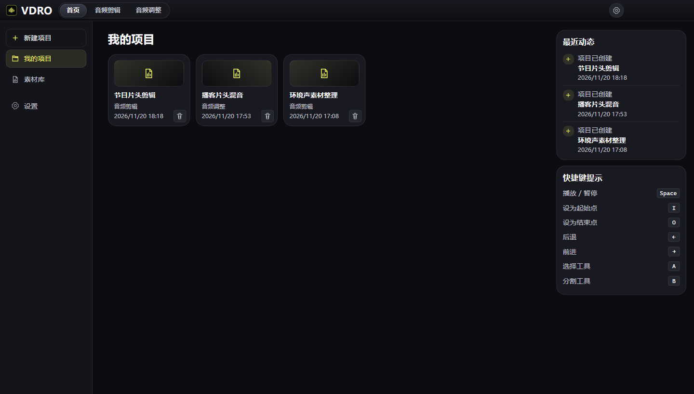
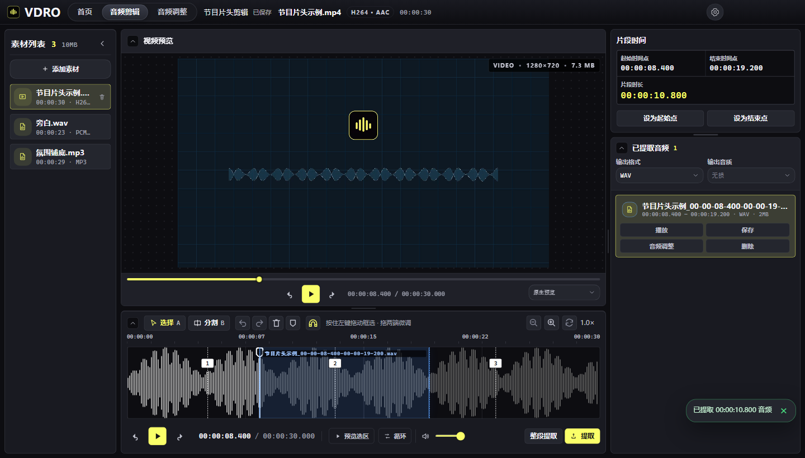
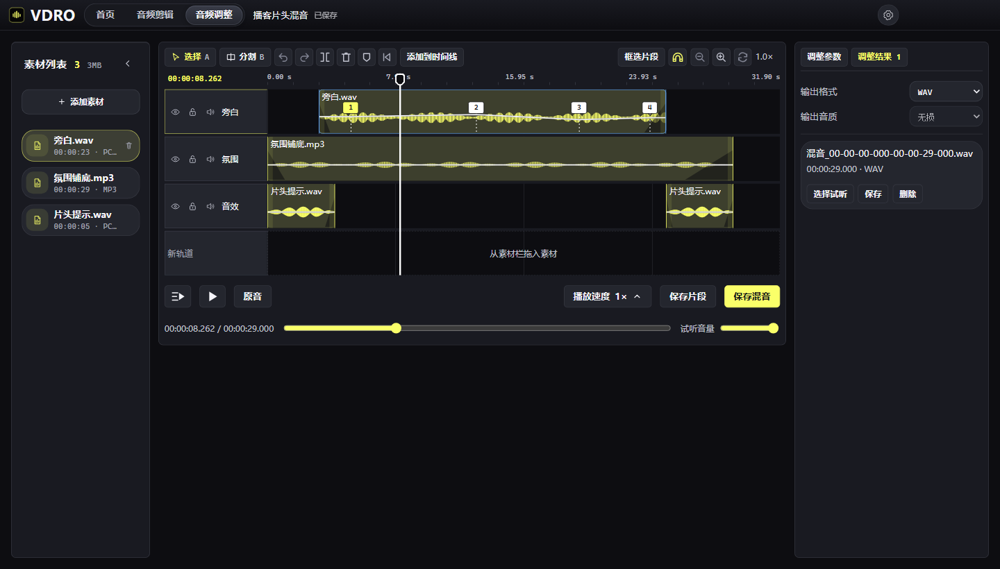

# VDRO

VDRO 是一款本地 Windows 音频工作台，支持从音频或视频中提取选段、调整音高和音量，以及将多条音轨混成一个文件。素材、项目草稿和输出文件均在本机读写。

**当前版本 1.3.3** · [下载安装包](https://github.com/assdazz/VDRO/releases/tag/v1.3.3) · [版本说明](docs/release-1.3.3.md)

## 项目首页

新建音频剪辑或音频调整项目，也可以继续已有项目和未命名草稿。各项目分别保存素材引用、编辑状态和结果记录。素材被移动或改名后，可从「待恢复素材」重新定位文件。



## 音频剪辑

从素材列表导入音频或视频，在波形上拖动框选，也可以通过起止时间、标记吸附和循环试听微调选段。处理视频时，预览画面和波形使用同一播放位置。选段可提取为音频，也可以送到音频调整工作区继续编辑。

两个工作区均使用纯色长方形标记。悬停可查看名称，右键可编辑名称和颜色或删除标记。



## 音频调整与多轨混音

将素材拖到时间线后，可以移动、裁剪、分割、倒放和设置静音。片段边缘可吸附到其他片段、标记及播放头。工具栏提供播放头处分割和撤销重做。音高标记支持分段变化，单个片段可设置音量、渐入渐出和共振峰保留。

实时试听用于选中片段，实时混音试听用于整条时间线。两者与原音共用进度条和试听音量，支持 0.5× 至 2× 倍速。播放时可以直接修改音高和音量。输出格式、音质和已生成结果放在「调整结果」，可保存单个片段或整个混音。



支持导出 WAV、MP3、M4A 和 FLAC，默认使用 WAV。采样率、声道和文件命名规则在软件设置中管理。[音频调整使用说明](docs/audio-adjustment.md)

## 安装与数据

Windows x64 安装包内置 Electron、FFmpeg 和 FFprobe。默认安装在 %LOCALAPPDATA%\Programs\VDRO，项目与设置保存在 %APPDATA%\VDRO。运行新版安装包可覆盖升级，卸载时保留用户数据。[安装与覆盖升级](docs/installer-upgrade.md)

设置支持中文和英文、界面主题、字体大小、缩放和自定义快捷键。视频预览可选择自动硬件解码或软件解码。[视频解码说明](docs/video-decoding.md)

## 从源码运行

需要 Node.js 20.19+ 或 22.12+ 和 npm。在 Windows 上克隆仓库后运行以下命令。

```powershell
git clone https://github.com/assdazz/VDRO.git
cd VDRO
npm.cmd ci
npm.cmd run dev
```

构建 Windows x64 安装包，输出到 release/。

```powershell
npm.cmd run typecheck
npm.cmd run build
npm.cmd run dist -- --publish never --config.electronDist=node_modules/electron/dist
```

## 许可证

VDRO 项目源码以 MIT 许可证发布。FFmpeg、Rubber Band 等第三方组件遵循各自的许可证。分发组合构建时请同时查阅相应的许可和源码说明。[MIT 许可证](LICENSE) · [音频引擎与第三方许可](docs/audio-engine.md)
